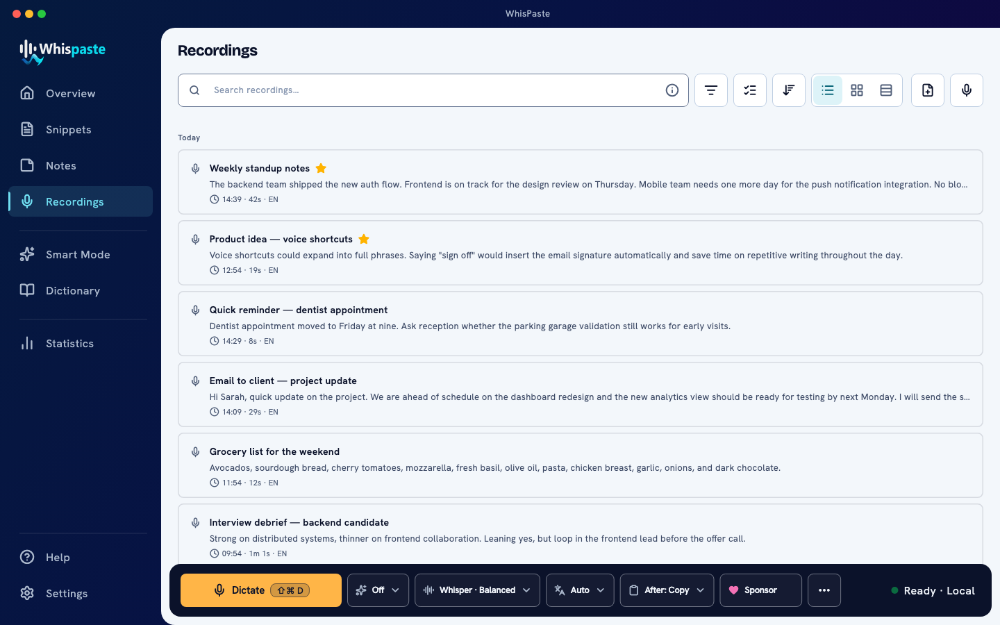
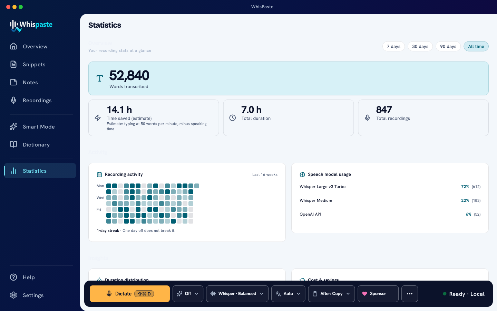
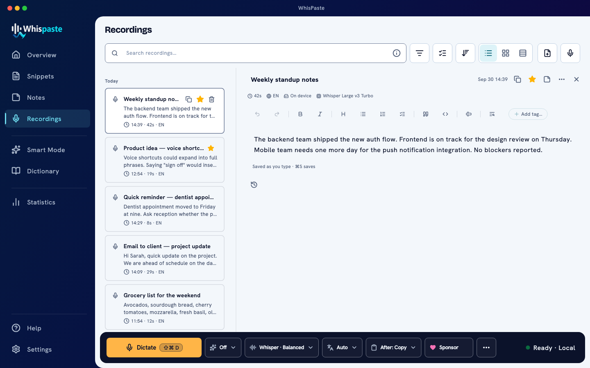
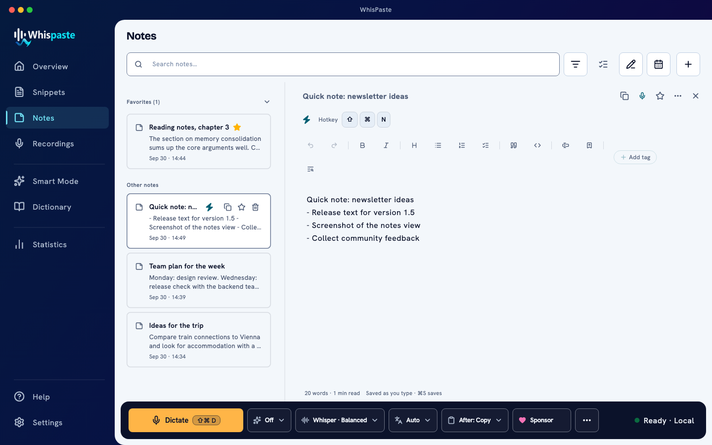
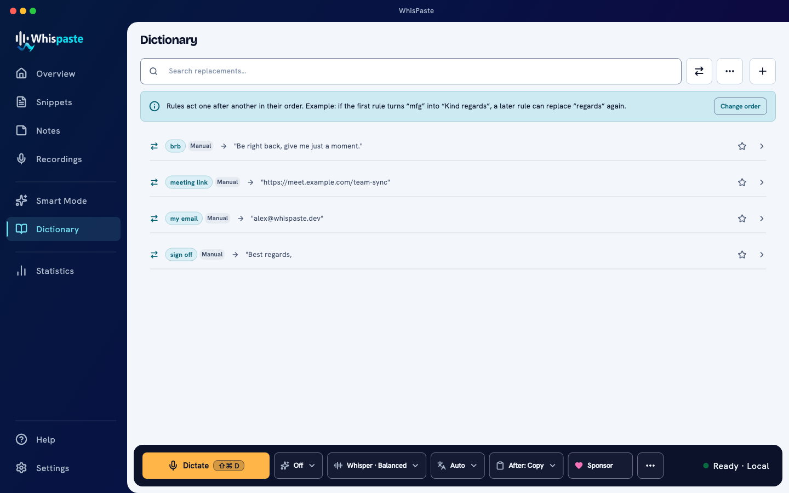

<h1 align="center">
  <br>
  WhisPaste
</h1>

<p align="center">
  <strong>Press. Speak. Done.</strong><br>
  Press a hotkey, speak, and your words land at the cursor in almost any app.<br>
  Free and open source. Speech recognition runs on your computer; cloud providers are optional.<br>
  <sub>Windows · macOS · Linux</sub>
</p>

<p align="center">
  <a href="https://github.com/whispaste/whispaste/releases/latest"></a>
  <a href="LICENSE"></a>
</p>

<h3 align="center">
  <a href="#install">Download</a>&ensp;·&ensp;<a href="https://whispaste.de/en/">Website</a>&ensp;·&ensp;<a href="https://github.com/whispaste/whispaste/discussions">Community</a>&ensp;·&ensp;<a href="https://app.votepit.com/silvio-und-maik/whispaste">Roadmap</a>
</h3>

<p align="center">
  
</p>

## How It Works

1. **Press your hotkey.** `Ctrl+Shift+D` by default (`⇧⌘D` on macOS), as push-to-talk or toggle.
2. **Speak naturally.** A small overlay shows a live waveform while the microphone is open.
3. **Done.** The text is pasted wherever your cursor sits: email, chat, editor, browser, terminal.

## Key Features

<table>
  <tr>
    <td width="50%" valign="top">
      <h3>On your computer, by default</h3>
      Two local engines: <a href="https://github.com/ggml-org/whisper.cpp">Whisper</a> (99 languages, GPU-accelerated) and NVIDIA Parakeet (~25 languages, several times faster). No account and no API key. OpenAI or Deepgram only if you choose them.
      <br><br>
    </td>
    <td width="50%" valign="top">
      <h3>Every dictation, kept and searchable</h3>
      Tags, full-text search, pin, merge, edit and export (TXT, MD, CSV, JSON, DOCX). An optional PIN locks your history.
      <br><br>
    </td>
  </tr>
  <tr>
    <td width="50%" valign="top">
      <h3>Notes and snippets</h3>
      Dictate into notes with images and version history. Spoken triggers expand into text or fill multi-field templates.
      <br><br>
    </td>
    <td width="50%" valign="top">
      <h3>Your words, spelled your way</h3>
      The dictionary fixes names and terms after every dictation. Smart Mode can clean up, shorten or translate on your device.
      <br><br>
    </td>
  </tr>
</table>

<details>
<summary><b>All features</b></summary>

**Core** — Global hotkey · Push-to-talk & toggle · Auto-paste into most apps (macOS/Windows/Linux; on Linux via a one-time uinput setup or the desktop portal; clipboard fallback without setup) · Recording overlay with waveform · Floating record button

**Transcription** — Offline by default, two local engines to choose from: [Whisper](https://github.com/ggml-org/whisper.cpp) ([99 languages](https://github.com/openai/whisper/blob/main/whisper/tokenizer.py), GPU-accelerated via Vulkan, with an optional CUDA pack for NVIDIA GPUs on Windows and Linux, after you accept the NVIDIA CUDA licence) or NVIDIA Parakeet (~25 languages, GPU-accelerated where available, CPU fallback, several times faster) — no API key required · Optional cloud providers (OpenAI, Deepgram) when you want them · Silence trimming at the end of a recording (Whisper engine) · Import audio and video files using the file picker, by dropping them onto the window or, for audio files, from the file manager's right-click menu (WAV; MP3, FLAC, M4A/AAC, Ogg/Opus; MP4, MOV, MKV, WebM, MPEG, VOB and MPEG-TS on macOS, Windows and Linux) — video audio is extracted locally by a bundled helper

**Reliability** — Startup checks re-verify microphone and auto-paste permissions on every launch, not just during first-run setup

**Productivity** — Smart Mode (optional on-device AI post-processing: cleanup, shorten, translate into 7 languages, plus your own named presets) · Edit selected text by voice (select text, press the selection hotkey, say what should change; off by default) · Voice Snippets, including interactive multi-field templates (spoken triggers → text expansion) · Quick-paste side panel (hover the left or right screen edge for transcriptions, snippets and clipboard history — macOS/Windows/Linux; on Linux the clipboard list is a snapshot taken when the panel opens, not a running history; off by default, turn it on in Settings; on macOS and Windows, apps such as password managers can be excluded from the history; on Linux, copies that password managers mark as confidential can be skipped) · Notes with titles, images and version history (lockable with the History PIN) · Audio feedback sounds · Local automation API for triggering dictation from your own scripts (opt-in, see [AUTOMATION_API.md](./AUTOMATION_API.md))

**Recordings** — Tags · Full-text search · Pin, archive, merge, edit · Analytics dashboard · Export (TXT, MD, CSV, JSON, DOCX) · Optional privacy gate and PIN lock (also withholds transcriptions from the side panel, floating-button menu and automation API; auto-lock after inactivity)

**System** — Auto-update with Ed25519-signed releases on macOS and Windows (Sparkle/WinSparkle); Linux checks for new versions and links to the release page; package-manager installs (Homebrew, Scoop) leave updates to the package manager · Dark theme · EN/DE/HE/RU/ES/PT interface · Autostart · System tray

</details>

## Install

| Windows 10 or later (x64) | macOS 13 or later (Apple Silicon) | Linux (x86_64) |
|---|---|---|
| [Installer](https://github.com/whispaste/whispaste/releases/latest/download/WhisPaste-Setup.exe) | [DMG](https://github.com/whispaste/whispaste/releases/latest/download/WhisPaste-macos-arm64.dmg) | [AppImage](https://github.com/whispaste/whispaste/releases/latest/download/WhisPaste-linux-x64.AppImage) |
| [Microsoft Store](https://apps.microsoft.com/detail/9p22jvkrq2v0) | [Mac App Store](https://apps.apple.com/app/id6795319409) | [`.deb`](https://github.com/whispaste/whispaste/releases/latest/download/WhisPaste-linux-x64.deb) (Ubuntu 26.04 or newer) |
| `winget install SilvioLindstedt.WhisPaste` | `brew install --cask whispaste/tap/whispaste` | `.tar.gz` on the [releases page](https://github.com/whispaste/whispaste/releases/latest) |
| `scoop bucket add whispaste https://github.com/whispaste/scoop-bucket`<br>`scoop install whispaste` | | |

<details>
<summary><b>System requirements and notes</b></summary>

- **Memory:** at least 8 GB of RAM recommended. A GPU is optional.
- **macOS:** 13.0 (Ventura) or newer, Apple Silicon only (Intel Macs and macOS 12 stay on 1.4.2).
- **Linux:** x86_64, Ubuntu 26.04 or newer with glibc 2.43 (older systems stay on 1.4.2). Only Ubuntu is verified.
- **Windows:** the files on GitHub are not code-signed, so SmartScreen may warn about a new version (“More info” → “Run anyway”). The Microsoft Store version is signed by Microsoft and avoids the warning.
- **Disk space** for the app and the speech models you download. The optional local Smart Mode model needs about 3 GB more.

</details>

### Buy or build yourself?

The [Microsoft Store](https://apps.microsoft.com/detail/9p22jvkrq2v0) and [Mac App Store](https://apps.apple.com/app/id6795319409) versions are a one-time purchase, no subscription; the store shows the current price.

- **What you get:** on Windows, installation without the SmartScreen warning and automatic updates through the Microsoft Store. On macOS, installation and updates through the App Store. A new version can reach the Mac App Store later than GitHub, because Apple reviews every update.
- **What the money is for:** further development, the Apple Developer Program, servers and store fees.
- **What buying does not change:** buying unlocks nothing; the free version stays complete. The GitHub downloads and copies you build from this repository have nothing locked, time-limited or tied to an account.
- **Where the versions differ:** the optional CUDA pack for recent NVIDIA cards is only available in the GitHub builds (Windows and Linux), not in the Microsoft Store version; GPU acceleration through Vulkan works in both. The Mac App Store version runs in Apple's app sandbox, so it cannot learn from corrections you make in other apps, does not detect password fields, has no AppleScript fallback for pasting and no tool to repair macOS permissions; the DMG from GitHub has all of these. The Mac App Store currently ships an older version, so audio and video file import reaches it with the next store update.
- **Updates and reminders in free builds:** on Windows and macOS the update check only offers a newer release from GitHub and installs nothing until you confirm; on Linux it only tells you about a new release and links to it, and you install it by hand. You can switch the check off in Settings. A quiet support card may appear on the Overview after you have used the app for a while, at most three times, and “Don't ask again” ends it.

## Privacy

- **Local mode** (offline speech recognition) — audio never leaves your device
- **Cloud mode** — audio goes directly to your selected provider, not through WhisPaste servers
- **No account required** — usage statistics and crash reports are on by default (anonymous, EU-hosted) and can each be switched off, and so can the update check
- **Open source** — audit every line

Details: [whispaste.de/en/privacy](https://whispaste.de/en/privacy/) and [NETWORK.md](NETWORK.md).

## Command line

<details>
<summary><b>Remote control, file transcription and diagnostics</b></summary>

Start, stop or cancel a dictation from a shortcut, launcher or script — handy on Wayland, where apps cannot grab global hotkeys themselves:

```sh
whispaste --start              # start a dictation (nothing if one is running)
whispaste --stop               # stop the dictation and transcribe it
whispaste --toggle             # start a dictation, or stop the running one
whispaste --cancel             # discard the running dictation
whispaste --transcribe memo.mp3  # transcribe files, like "Add files"
whispaste --help               # list the commands
```

The call is forwarded to the running WhisPaste and the second process exits right away; no second window opens. If WhisPaste is not running, `--start`, `--toggle` and `--transcribe` start it first; `--stop` and `--cancel` do nothing. An unknown command, a missing file or a file type the import does not read prints a message to stderr and exits with 64 (wrong use) or 66 (file), without starting anything. On Linux and macOS, `pkill -USR2 -x whispaste` toggles too, without starting a second process (only send it to a running instance).

The Mac App Store version cannot read files named on the command line (sandbox); use `open -a WhisPaste memo.mp3` there. The Microsoft Store version provides the command `whispaste` on the PATH. On Windows the console does not wait for WhisPaste; for the exit code use `start /wait` (cmd) or `Start-Process -Wait -PassThru` (PowerShell).

On GNOME and KDE under Wayland, WhisPaste's hotkey works in other apps only after the desktop binds it. If it does not, Settings and onboarding show the reason and a button to ask the desktop again; without a portal, the same notice names the keyboard settings to use.

| Platform | Command |
|---|---|
| Linux (`.deb`) | `whispaste --toggle` |
| Linux (AppImage) | `/path/to/WhisPaste-linux-x64.AppImage --toggle` |
| macOS | `open -n -a WhisPaste --args --toggle` |
| Windows (installer) | `"%LOCALAPPDATA%\Programs\WhisPaste\whispaste.exe" --toggle` |
| Windows (Microsoft Store) | `whispaste --toggle` |

**GNOME:** Settings → Keyboard → View and Customize Shortcuts → Custom Shortcuts → **+**. Name `WhisPaste`, command `whispaste --toggle`, then set the shortcut. Add a second one with `whispaste --cancel` if you like.

**KDE Plasma 6:** System Settings → Keyboard → Shortcuts → **Add New** → **Command or Script…**, enter `whispaste --toggle` and assign the shortcut. (Plasma 5: System Settings → Shortcuts → Custom Shortcuts → Edit → New → Global Shortcut → Command/URL.)

**Transcribe a file without the app / benchmark** (not the same as `--transcribe` above: runs on its own and prints the result)

```sh
whispaste --transcribe-file clip.wav [--engine whisper|parakeet] [--model whisper-small] \
  [--repeat 5] [--language en] [--gpu auto|enabled|disabled] [--replacements] [--json] [--out report.json]
```

Transcribes a 16 kHz mono 16-bit WAV with an already downloaded on-device model and exits — no hotkeys, tray or dictation UI are started. `--json` prints load time, per-run inference time and real-time factor instead of the text, plus the compute backend and GPU device the engine ran on. `--gpu disabled` forces the CPU, like "CPU only" in the settings. It runs separately from an open WhisPaste and does not change its settings. On Windows, use `--out` to get the report, as the console output of the app is not reliable there.

`whispaste --diagnose [--out report.json]` checks that an installation starts and that its bundled on-device engine libraries load, prints a JSON report and exits with 0 (ok) or 1. The release pipeline runs it against every package before publishing. On Linux it also runs without a display: it then starts a private Xvfb for the check, and exits with 2 if Xvfb is not installed.

</details>

## Help and feedback

- **Questions:** [Discussions › Q&A](https://github.com/whispaste/whispaste/discussions/categories/q-a)
- **Bugs:** [open an issue](https://github.com/whispaste/whispaste/issues/new/choose) (in the app: Help › Copy debug info)
- **Ideas:** [vote on the roadmap board](https://app.votepit.com/silvio-und-maik/whispaste) — it shows the rough direction, not a binding schedule
- **Security issues:** report privately, see [SECURITY.md](SECURITY.md)

## Contributing

Bug reports, translations and pull requests are welcome. Start with [CONTRIBUTING.md](CONTRIBUTING.md) (translations: [CONTRIBUTING_TRANSLATIONS.md](CONTRIBUTING_TRANSLATIONS.md)) and the [Code of Conduct](CODE_OF_CONDUCT.md).

To build from source:

```bash
git clone https://github.com/whispaste/whispaste.git
cd whispaste
flutter pub get
flutter run -d windows   # or: flutter run -d macos / flutter run -d linux
```

[BUILD.md](BUILD.md) covers the bundled on-device engines and the full toolchain per OS; [ARCHITECTURE.md](ARCHITECTURE.md) explains how the code is organized.

## Support the project

WhisPaste is free and stays free. If it saves you time, you can support it via
[PayPal](https://www.paypal.com/donate/?hosted_button_id=GY8ZQQGJB9XPY), [Ko-fi](https://ko-fi.com/silviol),
[Buy Me a Coffee](https://buymeacoffee.com/silvio.lindstedt) or
[GitHub Sponsors](https://github.com/sponsors/silvio-l). In the app, Help › Support lists every way to help;
the Microsoft Store and Mac App Store versions offer an optional one-time tip through the store. External support unlocks nothing.

## License

[MIT](LICENSE). Third-party components: [THIRD_PARTY_NOTICES.md](THIRD_PARTY_NOTICES.md).
The optional CUDA acceleration pack is a separate download that contains NVIDIA redistributables under the NVIDIA CUDA Toolkit EULA, not under this project's licence. Its terms (including no reverse engineering and keeping notices intact) apply to those files.

<p align="center">
  <sub>Made by <a href="https://github.com/silvio-l">Silvio Lindstedt</a></sub>
</p>
